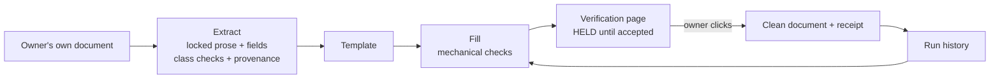

# Doc Factory

An AI skill kit that turns a business's own proven documents into checked,
traceable templates.

> Portfolio piece. Source shown for review only; not licensed for use. See LICENSE.

## What it does

A business hands over a document it already trusts: an engagement letter, a
client update, a change order. The kit turns it into a locked template with
fill-in **fields**. Every document built from that template is checked against
what that kind of document has to carry. Every section points back to the
source wording it came from. Nothing is released until the owner has read the
result and clicked to accept it, and that acceptance is logged.

It runs inside whatever AI assistant the owner already uses. There is no
server, no build step and nothing to buy beyond the kit.

## The problem

Small offices send the same kinds of documents over and over, and they do it
by re-editing last month's letter. Old client names leak into new letters,
one-off promises quietly become standing policy, and gaps nobody noticed get
copied forward for years. Generic AI writing tools make this worse: they
replace the firm's proven wording with their own prose and give no record of
where a sentence came from or who approved it.

Doc Factory keeps the firm's own wording as the asset and the owner as the
author of every document. It takes the re-editing and checking work off the
people already doing it.

## How it works

The kit is a set of markdown skill files the AI follows, plus small plain-Node
scripts for everything that must come out the same way every time. **Extract**
(`workflows/extract-template.md`) reads the owner's document, separates locked
prose from per-client fields, runs the document-class checks against it, and
records provenance (`L1`, `L2`... for each locked paragraph). **Fill and
render** (`workflows/fill-and-render.md`) asks for the fields, runs the
mechanical checks in `references/universal-checks.js`, and produces one
offline verification page. That page (`references/verify-page.html`) holds the
document behind a watermark until the owner ticks the attestation and clicks.
The click stamps a receipt with the date, version, sources and any accepted
flags. Each run also writes a history sidecar, so the next run for the same
client starts from what was promised last time.



## Features

- **Templates come only from the client's own documents.** The kit never sells
  them its own prose. A labelled fallback skeleton exists for a customer with
  nothing on file.
- **A judgment library by document class** (`references/document-classes.md`):
  engagement letter, client update, change order, fee notice, proposal,
  general. It names what each must carry and what it commonly omits. Checks
  run once on the owner's source document and again on every document built
  from it. A waived check is recorded and never nags again.
- **Seven named refusals.** No document of their own; under 150 words of locked
  prose or over 60% variable; fewer than three fields; a specific client's name
  or matter facts inside locked prose; a one-off promise inside locked prose;
  someone else's document; a field a STOP-severity check depends on left empty.
  Each one stops and says why, quoting the exact line where relevant.
- **Deterministic checks as code.** `universal-checks.js` holds the extraction
  counts, the standing-promise scan, and seven fill-time checks: surviving
  blanks, placeholder prose, vague dates, vague amounts, name spelling, sender
  identity, and another client's name leaking in. A hand-application rules
  table in the same file covers runtimes with no code execution.
- **The verification gate.** Offline, no network, no CDN. Disabled until
  ticked, one click, one stamp, cannot be double-stamped.
- **Run history.** Stable fields pre-fill, and overdue commitments from a prior
  run are surfaced before the next letter goes out.
- **Stated capability tiers.** Full (coding agent with Node), code sandbox (a
  chat app that can run code), and chat-only. Each tier documents what it can
  and cannot do. A chat-only run is labelled degraded, because its checks are
  self-reported by the AI rather than script-enforced.
- **No legal advice.** The kit reports what is missing from a document, never
  what it should say, and names the owner's attorney as the person to ask.
- **Four worked examples** in `examples/`, including one that correctly ends
  with no template.

## Stack

Markdown skill files (harness-agnostic: Claude, Codex, ChatGPT and others),
plain JavaScript with no dependencies, Node 22.6.0+ for the deterministic
checks (`node --test`), and self-contained HTML for the form and verification
page.

## Status

Experimental, version 1.0.5. The 12 plain-Node tests pass, and the gate logic
has been exercised against a synthetic DOM. No human has yet run the full path
on a real device, and the claude.ai web install path is untested.
`CHANGELOG.md` has the full history.

## Running it locally (for reviewers)

```bash
node --test skills/doc-kit/references/universal-checks.test.js
```

Open `skills/doc-kit/references/verify-page.html` in a browser to see the
gate. The kit's own install and operating docs are `START-HERE.md`,
`installer.md` and `OPERATIONS-MANUAL.md`.

## Screenshots

None in the repo.

## Author

Rico Rojas, rico@rtech-consulting.com, https://rico-rojas.com
