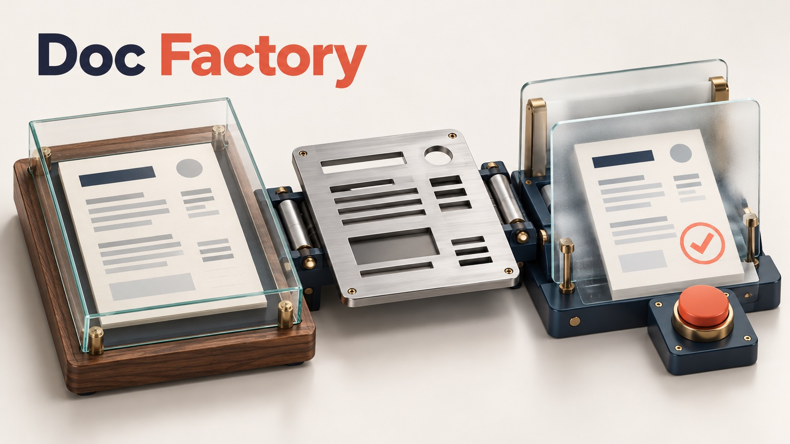
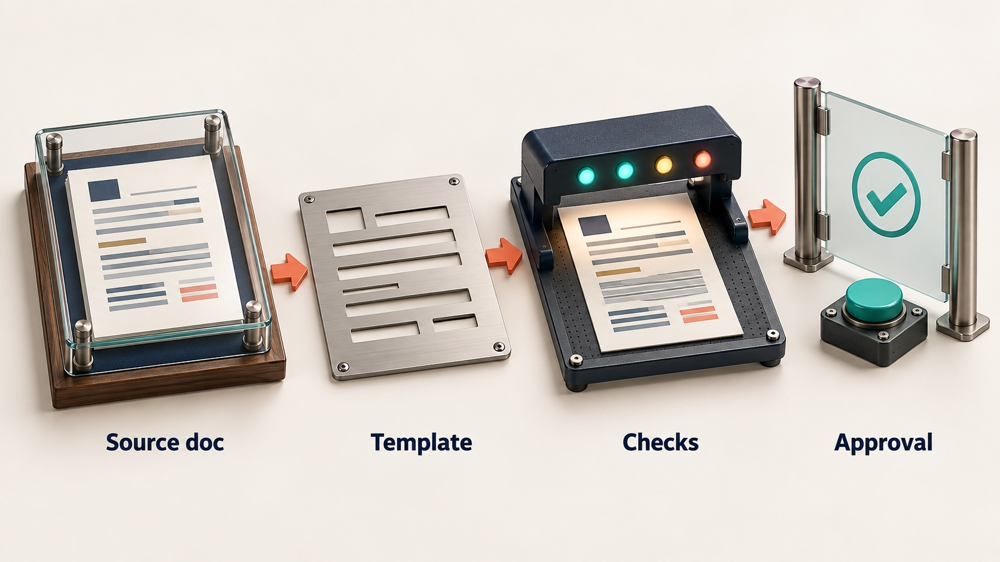
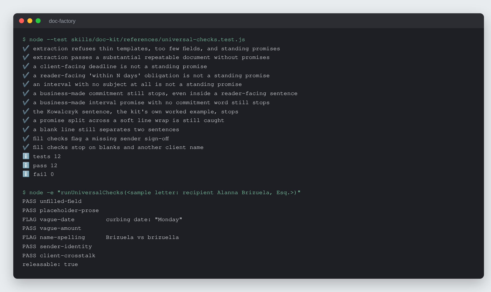

# Doc Factory

Turn a business's own proven documents into checked, traceable templates that
release nothing until the owner reads the result and accepts it.


-f7df1e)



## What it is

An AI skill kit for small offices. A business hands over a document it already
trusts: an engagement letter, a client update, a change order. The kit turns
it into a locked template with fill-in fields. Every document built from that
template is checked against what that kind of document has to carry, every
section points back to the source wording it came from, and nothing is
released until the owner has read the result and clicked to accept it. That
acceptance is logged as a receipt.

It runs inside whatever AI assistant the owner already uses (Claude, ChatGPT,
Codex and others). There is no server, no build step and no package to
install; Node 22.6 or newer runs the deterministic checks where it is
available.

## Why it exists

Small offices send the same kinds of documents over and over, and they do it
by re-editing last month's letter. Old client names leak into new letters,
one-off favours quietly become standing policy, and gaps nobody noticed get
copied forward for years. Generic AI writing tools replace the firm's proven
wording with their own prose and keep no record of where a sentence came from
or who approved it.

Doc Factory keeps the firm's own wording as the asset and the owner as the
author of every document. It takes the re-editing and checking off the people
already doing that work, so they spend their time on the parts that need them.

## How it works



The kit is a set of markdown skill files the AI follows, plus one plain-Node
script for everything that must come out the same way every time.
**Extract** (`skills/doc-kit/workflows/extract-template.md`) reads the owner's
document, separates locked prose from per-client fields, runs the
document-class checks against it, and numbers each locked paragraph (`L1`,
`L2`, ...) with its source. **Fill and render**
(`skills/doc-kit/workflows/fill-and-render.md`) asks only for what changed,
runs the mechanical checks in `references/universal-checks.js`, and produces
one offline verification page (`references/verify-page.html`). That page holds
the document behind a watermark until the owner ticks the attestation and
clicks; the click stamps a receipt with the date, version, sources and any
accepted flags. Each run writes a history sidecar, so the next letter to the
same client starts from what was promised last time.

## Features

- **Templates come only from the client's own documents.** A labelled
  fallback skeleton exists for a business with nothing on file.
- **A judgment library by document class** (`references/document-classes.md`):
  engagement letter, client update, change order, fee notice, proposal,
  general. Each names what the document must carry and what it commonly
  omits. A check the owner waives is recorded and does not come back.
- **Seven named refusals.** No document of their own; under 150 words of
  locked prose or over 60% variable; fewer than three fields; a specific
  client's name or matter facts inside locked prose; a one-off promise inside
  locked prose; someone else's document; a field a STOP-severity check depends
  on left empty. Each one stops and says why, quoting the line.
- **Deterministic checks as code.** `universal-checks.js` holds the extraction
  counts, the standing-promise test and seven fill-time checks: surviving
  blanks, placeholder prose, vague dates, vague amounts, recipient-name
  spelling (honorific- and suffix-aware, with near-miss detection), sender
  identity, and another client's name leaking in. A rules table in the same
  file covers runtimes with no code execution.
- **The verification gate.** Offline, no network, no CDN. Disabled until
  ticked, one click, one stamp, cannot be double-stamped.
- **Run history.** Stable fields pre-fill, and overdue commitments from a
  prior run are raised before the next letter goes out.
- **Stated capability tiers.** Coding agent with Node, chat app with a code
  sandbox, and chat-only. A chat-only run is labelled degraded, because its
  checks are self-reported by the AI rather than script-enforced.
- **No legal advice.** The kit reports what is missing from a document, never
  what it should say, and tells the owner to ask their own adviser.
- **Four worked examples** in `examples/` (landscaping, accounting, mechanical
  contracting, title), including one that correctly ends with no template.

## Run it locally (for review)

Requires Node 22.6 or newer. No packages to install.

```sh
git clone https://github.com/rodaddy/doc-factory.git
cd doc-factory

# The deterministic checks and their tests
node --test skills/doc-kit/references/universal-checks.test.js

# The verification gate opens offline in any browser
open skills/doc-kit/references/verify-page.html
```



*`node --test` on the check suite, then `runUniversalChecks()` called with
`node -e` on a three-line sample letter addressed to "Ms. Brizuella" for a
recipient named "Alanna Brizuela, Esq." with the date field set to "Monday".*

To use the kit itself, open `START-HERE.md` and give `installer.md` to your AI
assistant. `OPERATIONS-MANUAL.md` is the plain-language guide for the owner.

**Licence:** free for personal and non-commercial use with credit; commercial
use needs a licence. See [LICENSE](LICENSE) (PolyForm Noncommercial 1.0.0) or
contact rico@rtech-consulting.com.

## Repository layout

- `START-HERE.md`, `installer.md`: the self-adapting installer
- `OPERATIONS-MANUAL.md`: the owner's guide
- `skills/doc-kit/`: the skill, workflows, document classes, checks script,
  verification page and the fallback template
- `examples/`: four complete worked runs
- `tiers/`: tier notes
- `docs/`: build story and README images

## How it was built

The kit went from a 68-word letter skeleton (July 2026) to an extract-first
product with a judgment library, provenance, run history and a click-to-accept
gate, through a review audit, three rounds of simulated-buyer runs and two
hardening passes with cross-model review. The full account, with dates and
what did not work, is in [docs/BUILD-STORY.md](docs/BUILD-STORY.md).

## Project status

Experimental, version 1.0.5. The 12 plain-Node tests pass. The gate logic has
been exercised in code and against a synthetic DOM; no person has yet run the
full path from a real document to a printed PDF on a real device, and the
claude.ai web install path is untested. `CHANGELOG.md` has the full history.

## Credits

Plain Node.js (`node:test`) with no third-party packages.

## Author

Rico Rojas, https://rico-rojas.com
